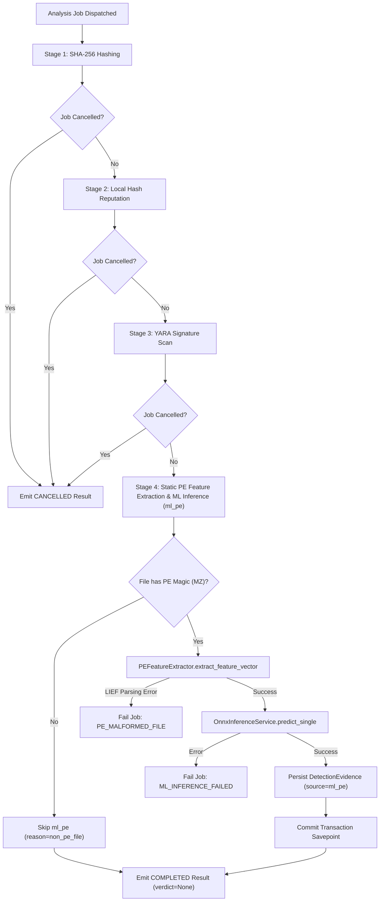

# T016 — Machine Learning Pipeline Integration Report

**Ticket:** T016 — ML Integration with the Analysis Pipeline  
**Epic:** Machine Learning Engine  
**Priority:** P1  
**Status:** DONE  
**Dependencies:** T011, T013, T015  

---

## 1. Executive Summary

This report documents the architectural design, implementation details, fault isolation mechanisms, relational evidence persistence, and comprehensive verification for Ticket **T016 (Machine Learning Pipeline Integration)**.

The verified Design A static PE classification model (ONNX graph exported from LightGBM during T015) has been integrated into Sentinel-EDR's core analysis orchestrator (`AnalysisOrchestrator`) and background worker pipeline. Submitted binaries now undergo static PE feature extraction (`PEFeatureExtractor`) conforming to the 2,381-dimensional `ember_pe_v2` schema, followed by hardware-accelerated ONNX inference (`OnnxInferenceService`). Successful classifications generate structured, idempotent `DetectionEvidence` records (`source="ml_pe"`) linked to the analysis job and correlated security incident.

### Strict Scope Boundaries Adhered To:
- **No Composite Risk Scoring or Verdict Synthesis:** The top-level `verdict` and `risk_score` attributes on `AnalysisResult` and `AnalysisJob` remain strictly `None`. Verdict aggregation belongs exclusively to **T020 (Verdict Aggregation)**.
- **No Automated Quarantine or Remediation:** Pipeline execution observes files in read-only mode. Remediation belongs to later response tickets.
- **Production Model Exclusivity:** Design A is exclusively deployed as the production model. Design B remains strictly experimental and is never used as a production fallback.
- **Zero Inferred Benign Decisions:** Unanalyzed, corrupt, or errored executables are never classified as benign.

---

## 2. Production Model Invariants

The production machine learning engine operates under strictly validated cryptographic and architectural invariants:

| Attribute | Specification | Verification Method |
|---|---|---|
| **Model Design** | Design A (Random Stratified 80/20 Pilot) | Verified during T014 audit & T015 parity audit |
| **Model Artifact** | `.data/experiments/t014-audit-v2/sentinel-pe-lightgbm-audit-v2.onnx` | Path resolved via `Settings.ml_model_path` |
| **Cryptographic SHA-256** | `5e3b72ee5f09e8d7d619dcd211c9d815aa16b147d02232589919afa76076ec8e` | Validated at load time via `ArtifactHashMismatchError` |
| **Metadata Artifact** | `.data/experiments/t014-audit-v2/sentinel-pe-lightgbm-audit-v2_onnx_metadata.json` | Validated against `shared/schemas/model_metadata.schema.json` |
| **Model Identifier** | `sentinel-pe-lightgbm-audit-v2` | Stored in metadata |
| **Model Version** | `1.0.0` | Semantic version string |
| **Feature Schema** | `ember_pe_v2` | Canonical EMBER 2018 v2 static PE contract |
| **Input Dimensions** | 2,381 numerical features (float32) | Checked via `InvalidInputDimensionError` |
| **Operating Threshold** | `0.8856` | Derived strictly on validation set targeting FPR $\le 0.005$ |
| **Secondary Model (Design B)** | `sentinel-pe-lightgbm-temporal.onnx` | Experimental control only; excluded from production |

---

## 3. Pipeline Integration Architecture

The Sentinel-EDR analysis pipeline in [`backend-api/app/services/analysis_orchestrator.py`](file:///D:/project/backend-api/app/services/analysis_orchestrator.py) executes as a sequential 4-stage pipeline with cooperative cancellation and transactional savepoints:



### Stage 4 Execution Logic:
1. **Configuration Gate:** If `ml_enabled=False` (default for lightweight testing), `modules_skipped.append("ml_pe")` and analysis continues without error.
2. **Path Gate:** If job lacks `file_path`, `modules_skipped.append("ml_pe")` and continues.
3. **PE Magic Inspection:** The file's first 2 bytes are checked for the DOS executable signature (`MZ` / `b"MZ"`). Non-PE files (scripts, plain text, documents) are gracefully skipped without failure (`modules_skipped.append("ml_pe")`).
4. **Static Feature Extraction:** Executed via `PEFeatureExtractor.extract_feature_vector()`. Malformed PE headers or corrupted section tables trigger `PE_MALFORMED_FILE` failure.
5. **Inference Execution:** The 2,381-dimensional vector is passed to `OnnxInferenceService.predict_single()`, returning `OnnxPredictionResult` with continuous probabilities and threshold-based classification.
6. **Summary Attachment:** An `MlDetectionSummary` object is created and attached to `AnalysisResult.ml_detection`.
7. **Relational Evidence Persistence:** `_persist_ml_evidence()` creates a `DetectionEvidence` record inside a nested database transaction savepoint.

---

## 4. Evidence Persistence and Relational Schema

Machine learning detection outputs are persisted as structured detection evidence conforming to the relational database schema:

### `DetectionEvidence` Attributes:
- **`evidence_id`:** Deterministic UUIDv5 generated from URL namespace:  
  `uuid5(NAMESPACE_URL, f"sentinel:evidence:{job.job_id}:ml:{ml_result.model_id}:{ml_result.model_version}")`  
  Guarantees idempotency on repeated analysis runs and retries without duplicate key violations.
- **`incident_id`:** Associated with the existing incident or a newly created correlated incident.
- **`analysis_job_id`:** Foreign key linking to the current `AnalysisJob`.
- **`source`:** Strictly `"ml_pe"`.
- **`indicator`:** `"{model_id}:{model_version}"` (e.g. `sentinel-pe-lightgbm-audit-v2:1.0.0`).
- **`severity`:** `"HIGH"` if `predicted_class == "MALICIOUS"`, `"LOW"` if `predicted_class == "BENIGN"`.
- **`confidence`:** Continuous malicious probability $P(\text{Malicious} \mid X) \in [0.0, 1.0]$.
- **`score_contribution`:** Strictly `None` (reserved for T020 multi-engine composite scoring).
- **`description`:** Explanatory summary including model version, classification, operating threshold, and feature schema.
- **`observed_value`:** Formatted string recording probability, threshold, and inference latency (e.g. `malicious_prob=0.9412, threshold=0.8856, latency_ms=0.04`).

---

## 5. Fault Isolation and Error Handling

To maintain endpoint stability and investigative integrity, the ML stage implements robust fault isolation:

### Safe Error Codes:
| Error Code | Trigger Condition | Pipeline Impact |
|---|---|---|
| `ML_MODEL_NOT_FOUND` | ONNX model artifact missing from disk | Job transitions to `FAILED`; prior YARA/Hash evidence preserved |
| `ML_CHECKSUM_MISMATCH` | ONNX model SHA-256 does not match configured digest | Job transitions to `FAILED`; prior YARA/Hash evidence preserved |
| `ML_MODEL_CORRUPT` | ONNX protobuf invalid or unparseable | Job transitions to `FAILED`; prior YARA/Hash evidence preserved |
| `ML_INFERENCE_FAILED` | Internal ONNX Runtime execution exception | Job transitions to `FAILED`; prior YARA/Hash evidence preserved |
| `PE_MALFORMED_FILE` | Binary has `MZ` header but cannot be parsed by LIEF | Job transitions to `FAILED`; prior YARA/Hash evidence preserved |
| `PE_PARSER_ERROR` | Feature vector contains NaN, Inf, or invalid dimensions | Job transitions to `FAILED`; prior YARA/Hash evidence preserved |
| `EVIDENCE_PERSISTENCE_FAILED` | Database failure during evidence insertion | Savepoint rolls back; job transitions to `FAILED` |

### Non-PE File Skipping:
Files lacking the `MZ` DOS header are skipped gracefully:
- `modules_skipped.append("ml_pe")`
- Analysis job status: `COMPLETED`
- `AnalysisResult.ml_detection`: `None`
- No false failure, no fabricated benign classification.

### Fault Isolation & Prior Evidence Retention:
If the ML stage fails after YARA or Hash stages have succeeded:
- Prior YARA `DetectionEvidence` records remain committed and associated with the incident.
- Prior `hash_reputation` summary remains intact on the failed `AnalysisResult`.
- The job failure is recorded explicitly without wiping preexisting forensic evidence.

---

## 6. Contracts and Cross-Stack Schema Updates

The shared contracts across Python backend, JSON Schema, and TypeScript frontend have been synchronized:

### 1. Python Pydantic Schema (`backend-api/app/schemas/contracts.py`):
```python
class MlDetectionSummary(BaseModel):
    model_config = ConfigDict(extra="forbid")
    model_id: str
    model_version: str
    artifact_hash: str
    feature_schema: str = "ember_pe_v2"
    malicious_probability: float = Field(..., ge=0.0, le=1.0)
    benign_probability: float = Field(..., ge=0.0, le=1.0)
    operating_threshold: float = Field(..., ge=0.0, le=1.0)
    predicted_label: int = Field(..., ge=0, le=1)
    predicted_class: Literal["BENIGN", "MALICIOUS"]
    inference_duration_ms: float = Field(..., ge=0.0)
    is_degraded: bool = False
```

### 2. JSON Schema (`shared/schemas/analysis_result.schema.json`):
Added strict `ml_detection` schema definition matching Pydantic contract bounds, required fields, and `additionalProperties: false`.

### 3. TypeScript Type Definition (`dashboard-ui/src/types/contracts.ts`):
```typescript
export interface MlDetectionSummary {
  model_id: string;
  model_version: string;
  artifact_hash: string;
  feature_schema: string;
  malicious_probability: number;
  benign_probability: number;
  operating_threshold: number;
  predicted_label: number;
  predicted_class: "BENIGN" | "MALICIOUS";
  inference_duration_ms: number;
  is_degraded: boolean;
}
```

### 4. System Status Route (`backend-api/app/api/routes/status.py`):
`_check_ml_engine_availability()` reports actual component state:
- `"disabled"`: When `settings.ml_enabled == False`.
- `"available"`: Model artifact exists, hash matches, and runtime session initializes.
- `"degraded"`: Artifact found but runtime session reports degraded status.
- `"unavailable"`: Model missing or corrupt.

---

## 7. Verification and Test Results

### 1. T016 Integration Test Suite (`tests/backend/test_ml_pipeline_integration.py`):
A dedicated 25-test suite comprehensively exercises all ML pipeline paths:
- **Test 1–3:** Service lifecycle, singleton management, and configuration defaults.
- **Test 4–6:** Missing model, hash mismatch, and corrupt model error handling.
- **Test 7–9:** Non-PE skipping, malformed PE handling, and non-existent file handling.
- **Test 10–13:** End-to-end synthetic benign and malicious PE classification and evidence persistence.
- **Test 14–16:** Decision boundaries around operating threshold ($0.8856$).
- **Test 17–19:** Evidence schema, deterministic UUIDv5, and retry idempotency.
- **Test 20–22:** YARA and ML coexistence, incident association, and fault isolation.
- **Test 23–25:** JSON schema serialization conformance and worker queue execution.

**Result:** `25 passed in 1.36s`

### 2. Full Backend Regression Suite:
```powershell
.\.venv\Scripts\python.exe -m pytest tests/backend -q
```
**Result:** `357 passed in 11.13s` (100% pass across all unit and integration tests).

### 3. Frontend Quality & Build Verification:
```powershell
Set-Location D:\project\dashboard-ui
npm run typecheck   # Exit code 0 (0 errors)
npm run lint        # Exit code 0 (0 warnings/errors)
npm run test        # 16 passed in 52.81s
npm run build       # Built production bundle in 10.41s
```

---

## 8. Completion Checklist

- [x] Design A (`sentinel-pe-lightgbm-audit-v2.onnx`) verified and exclusively integrated as production ML model.
- [x] Design B remains experimental and is not used in production pipeline.
- [x] Static PE feature extraction (`PEFeatureExtractor`) extracting 2,381 `ember_pe_v2` float32 features.
- [x] Non-PE files skipped safely without classification or job failure.
- [x] Corrupt or malformed PE files fail with explicit error codes (`PE_MALFORMED_FILE`).
- [x] Continuous malicious probability evaluated against operating threshold `0.8856`.
- [x] Idempotent `DetectionEvidence` records (`source="ml_pe"`) persisted with deterministic UUIDv5.
- [x] Pre-existing Hash and YARA evidence preserved upon ML failure.
- [x] Top-level analysis `verdict` and `risk_score` remain strictly `None` (deferred to T020).
- [x] Backend contracts, JSON Schema, and TypeScript types synchronized.
- [x] 357 backend tests passing; frontend typecheck, lint, tests, and build passing.
- [x] Stop after T016; do not start T017.
